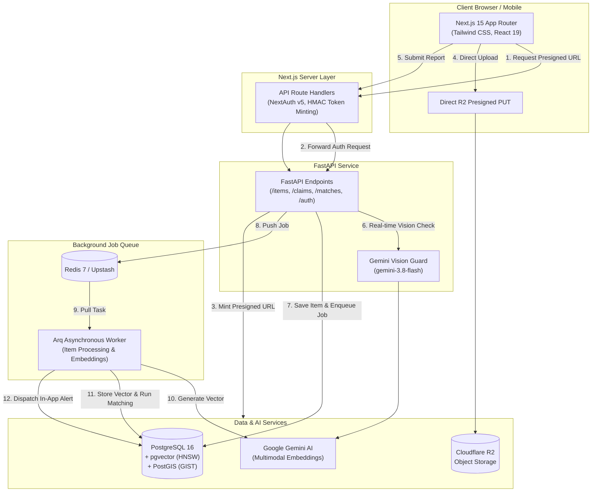
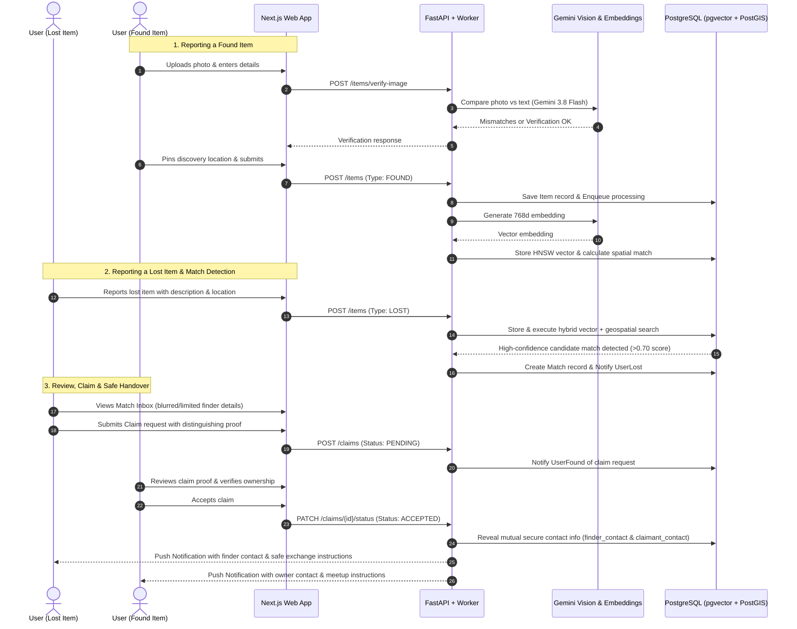

# 🔍 Lost & Found Registry — AI-Powered Spatial & Visual Recovery Engine

[-black?style=for-the-badge&logo=next.js)](https://nextjs.org/)
[](https://fastapi.tiangolo.com/)
[](https://www.postgresql.org/)
[](https://github.com/pgvector/pgvector)
[](https://postgis.net/)
[](https://ai.google.dev/)
[](https://www.cloudflare.com/products/r2/)

An enterprise-grade, privacy-first **Lost & Found recovery platform** that replaces static notice boards with an autonomous **multimodal semantic search and spatial matching engine**. 

Built with **Next.js 15**, **FastAPI**, **PostgreSQL with PostGIS + pgvector**, **Arq/Redis**, and **Google Gemini Vision & Multimodal Embeddings**.

---

## 🌟 Key Highlights for Reviewers & Recruiters

- **Multimodal Semantic Matching (`pgvector` + HNSW)**: Instead of brittle keyword searches, text and photographic evidence are translated into dense vector embeddings (`gemini-embedding-2`, 768 dimensions) indexed via Hierarchical Navigable Small World (HNSW) graphs for sub-millisecond similarity scoring.
- **Geospatial Discovery (`PostGIS`)**: Integrates real-world spatial radius queries using PostGIS `ST_DWithin` and `geography(Point, 4326)` with GIST indexing to guarantee proximity-aware matching.
- **Gemini Vision Image Mismatch Guard**: Validates user-uploaded photos against textual descriptions using `gemini-3.8-flash`. If an obvious contradiction occurs (e.g., user reports an "iPhone red" but photo displays a "Samsung lavender"), the app provides side-by-side visual diffs and 3 resolution workflows.
- **Zero-Knowledge Safe Handover Protocol**: Item ownership is guarded cryptographically and procedurally. Claimant contact details remain sealed until the finder evaluates ownership questions/answers and formally approves the claim.
- **Asynchronous Event-Driven Architecture**: Fast API ingestion queues heavy visual verification and vector generation to an asynchronous Redis worker pool (`arq`), preventing UI blocking and ensuring horizontal scalability.

---

## 🏗️ Architecture & System Topology



---

## 🔄 End-to-End User & Handover Lifecycle



---

## 🛠️ Technology Stack

| Layer | Technologies | Purpose |
| :--- | :--- | :--- |
| **Frontend** | **Next.js 15**, React 19, Tailwind CSS v4, Lucide Icons, Leaflet/OpenStreetMap | Responsive, high-performance UI with Turbopack, client-side routing, and interactive maps |
| **Authentication** | **NextAuth.js v5**, Google OAuth 2.0, Secure Credentials Provider | Passwordless Google sign-in and JWT-backed user authentication |
| **Backend API** | **FastAPI**, Python 3.12, Uvicorn, Pydantic v2 | High-throughput async REST API with automatic OpenAPI validation |
| **Database** | **PostgreSQL 16**, SQLAlchemy 2.0 (asyncpg), Alembic | Relational storage for users, items, matches, claims, and audit logs |
| **Vector Engine** | **`pgvector`** with HNSW Indexing | High-dimensional cosine distance similarity search on item embeddings |
| **Geospatial Engine** | **`PostGIS`** with GIST Indexing (`geography(Point, 4326)`) | Fast `ST_DWithin` bounding radius filtering for local item discovery |
| **AI & Multimodal** | **Google Gemini (`gemini-3.8-flash`, `gemini-embedding-2`)** | Zero-shot image verification and dense multimodal text/visual embeddings |
| **Task Queue** | **`arq`**, Redis 7 | Event-driven background worker pipeline for embedding generation |
| **Object Storage** | **Cloudflare R2** (S3-compatible) | Zero-egress secure photographic evidence hosting with presigned URLs |

---

## 🔒 Security & Privacy Architecture

1. **Zero-Knowledge Privacy Before Verification**:
   - When a match is discovered, claimant users cannot inspect raw private finder details or sensitive item markers.
   - Claimants must answer verification questions or describe non-public attributes (e.g., engraving, lock screen wallpaper, specific interior contents).
2. **Mutual Consent Contact Disclosure**:
   - Contact coordinates (`email`, `finder_contact`, `claimant_contact`) are strictly gated by the backend until the finder confirms verification.
3. **Internal API Secret Protection**:
   - Backend routes that require elevated system access are signed with a shared HMAC secret (`INTERNAL_API_SECRET`), preventing spoofing and unauthenticated backend invocation.
4. **No-Self Matching Constraint**:
   - Embedding and match generation engines strictly enforce `exclude_user_id` filters, preventing users from matching against their own lost/found submissions.

---

## 💻 Local Development Setup

### Prerequisites
- **Node.js** >= 18.18
- **Python** >= 3.11
- **PostgreSQL** with `pgvector` and `postgis` extensions enabled
- **Redis** server running locally (or via Docker)

---

### 1. Database Setup (Docker)
The fastest way to run PostgreSQL with both `pgvector` and `postgis` enabled:

```bash
docker run -d \
  --name lost-found-postgres \
  -e POSTGRES_USER=postgres \
  -e POSTGRES_PASSWORD=postgres \
  -e POSTGRES_DB=lost_found_db \
  -p 5432:5432 \
  postgis/postgis:16-3.4
```

Enable `pgvector` inside the database:
```sql
CREATE EXTENSION IF NOT EXISTS vector;
CREATE EXTENSION IF NOT EXISTS postgis;
```

---

### 2. Backend Setup

```bash
cd backend

# Create virtual environment
python -m venv .venv

# Activate virtual environment
# Windows:
.venv\Scripts\activate
# Linux/macOS:
# source .venv/bin/activate

# Install dependencies
pip install -r requirements.txt

# Configure environment variables
cp .env.example .env
# Edit .env with your PostgreSQL, Cloudflare R2, and Gemini API keys

# Run Alembic database migrations
alembic upgrade head

# Start FastAPI development server
uvicorn app.main:app --reload --port 8000
```

---

### 3. Background Worker Setup
In a separate terminal window:

```bash
cd backend
.venv\Scripts\activate
arq app.worker.WorkerSettings
```

---

### 4. Frontend Setup

```bash
cd frontend

# Install dependencies
npm install

# Configure environment variables
cp .env.example .env.local
# Edit .env.local with your backend URL, NextAuth secrets, and Google OAuth credentials

# Start Next.js development server
npm run dev
```

Visit [http://localhost:3000](http://localhost:3000) to view the application.

---

## 🚀 Production Deployment Roadmap (Free Tier)

This application can be deployed with **$0/month hosting costs** using modern developer platforms:

```
┌────────────────────────────────────────────────────────┐
│                   Vercel (Frontend)                    │
│   Next.js 15 SSR / Edge Middleware / Turbopack        │
└──────────────────────────┬─────────────────────────────┘
                           │ Server-to-Server API Calls
┌──────────────────────────▼─────────────────────────────┐
│               Render / Koyeb (Backend)                 │
│         FastAPI (Web) + Arq Worker (Process)           │
└──────┬───────────────────┬──────────────────────┬──────┘
       │                   │                      │
┌──────▼──────┐     ┌──────▼──────┐        ┌──────▼──────┐
│  Supabase   │     │   Upstash   │        │Cloudflare R2│
│  PostgreSQL │     │ Serverless  │        │   Storage   │
│+pgvector+GIS│     │    Redis    │        │  (10GB Free)│
└─────────────┘     └─────────────┘        └─────────────┘
```

### 1. Database: **Supabase** (Permanent Free Tier)
- Create a free project at [supabase.com](https://supabase.com).
- Go to **Database > Extensions** and enable:
  - `vector`
  - `postgis`
- Copy your direct connection string (URI mode, port 5432 or 6543 pooler) into `DATABASE_URL`.

### 2. Queue & Cache: **Upstash Redis** (Permanent Free Tier)
- Create a free Redis database at [upstash.com](https://upstash.com) (10,000 free commands/day).
- Copy the standard `rediss://...` TLS connection string into `REDIS_URL`.

### 3. Object Storage: **Cloudflare R2** (Permanent Free Tier)
- Create an R2 bucket named `lost-found-images` at [cloudflare.com](https://dash.cloudflare.com).
- Generate API tokens with Read & Write permissions.
- Under bucket **Settings > CORS**, add a policy allowing `PUT`, `GET`, `HEAD` from your production frontend domain.

### 4. Backend & Worker: **Render** / **Koyeb** (Free Tier)
- Fork or connect your GitHub repository.
- **Web Service**:
  - Build command: `pip install -r requirements.txt && alembic upgrade head`
  - Start command: `uvicorn app.main:app --host 0.0.0.0 --port $PORT`
- **Background Worker**:
  - Start command: `arq app.worker.WorkerSettings`

### 5. Frontend: **Vercel** (Permanent Free Tier)
- Import your GitHub repository to [vercel.com](https://vercel.com).
- Framework preset: `Next.js`.
- Set Environment Variables (`BACKEND_URL`, `INTERNAL_API_SECRET`, `AUTH_SECRET`, `AUTH_GOOGLE_ID`, `AUTH_GOOGLE_SECRET`, `NEXTAUTH_URL`).
- Automatic deployment triggers on every `git push`.

---

## 🧪 Testing & Validation

```bash
# Run backend test suite
cd backend
pytest -v

# Run frontend TypeScript & lint checks
cd frontend
npx tsc --noEmit
npm run lint

# Production build verification
npm run build
```

---

## 📄 License
This project is open-source under the MIT License.
